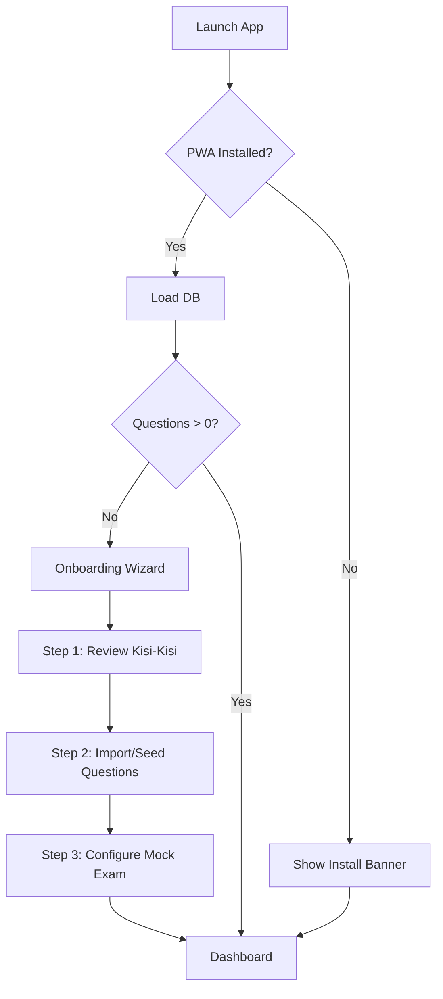
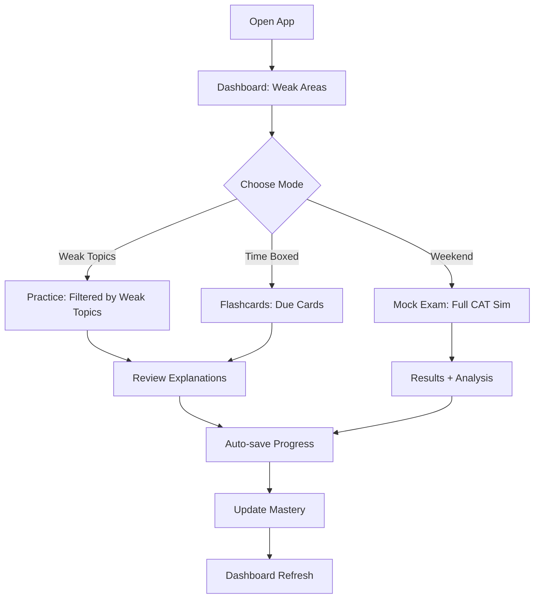
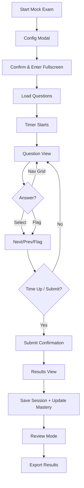

# Product Requirements Document (PRD)
## CPNS BMKG Meteorology & Geophysics Observer Exam Prep Webapp

**Version**: 1.0  
**Status**: Draft for Review  
**Date**: 2025-01-22  
**Author**: [Your Name]  
**Project**: CPNS BMKG SKB Offline Prep Tool

---

## 1. Executive Summary

### 1.1 Product Vision
An offline-first, single-user Progressive Web App (PWA) that enables focused, measurable preparation for the **Seleksi Kompetensi Bidang (SKB)** Computer Assisted Test (CAT) for **Pengamat Meteorologi dan Geofisika Ahli Pertama** at BMKG.

### 1.2 Target Outcome
- **Primary**: Pass the SKB CAT exam with a competitive score (>85th percentile)
- **Secondary**: Build lasting competency in all 21 kisi-kisi topics for on-the-job readiness
- **Tertiary**: Create a reusable, extensible tool for future BMKG exam cycles

### 1.3 Success Metrics
| Metric | Target | Measurement |
|--------|--------|-------------|
| Topic coverage | 100% (21/21 topics) | Question tags in DB |
| Question bank size | ≥ 500 questions | Total questions indexed |
| Mock exam realism | ≥ 90% fidelity | User rating vs. actual CAT |
| Offline reliability | 100% | Zero network requests at runtime |
| Study session retention | ≥ 30 min avg | Analytics events |
| Data export success | 100% | Test restore from backup |

---

## 2. User Personas & Context

### 2.1 Primary Persona: "The Aspirant"
- **Name**: You (single user)
- **Background**: S1/D4 in Meteorology, Geophysics, Computer Science, Instrumentation, or related
- **Goal**: Pass CPNS BMKG SKB 2025/2026
- **Constraints**: 
  - Limited study time (evenings/weekends)
  - Unreliable internet during commute/travel
  - Prefers active recall over passive reading
  - Needs to identify weak areas efficiently
- **Tech comfort**: High (comfortable with browser dev tools, JSON, CLI)

### 2.2 Usage Contexts
| Context | Device | Network | Session Length | Primary Mode |
|---------|--------|---------|----------------|--------------|
| Deep study | Laptop | WiFi | 60-120 min | Practice + Review |
| Commute | Phone | Offline | 15-30 min | Flashcards |
| Mock exam | Laptop | Offline | 90 min | Mock Exam (CAT) |
| Quick review | Phone | Offline | 5-10 min | Weak areas dashboard |

---

## 3. Functional Requirements

### 3.1 Competency Framework (Kisi-Kisi Management)

#### FR-KF-01: Topic Registry
- **Description**: Maintain the official 21-topic kisi-kisi as immutable reference data
- **Details**:
  - 9 Kemampuan Umum (UM-01 to UM-09)
  - 12 Kemampuan Khusus (KH-01 to KH-12)
  - Each topic: code, title, sub-domain (Meteorology/Climatology/Geophysics/Instrumentation), description, weight hint
- **Storage**: Static JSON (`data/kisi-kisi.json`), loaded at build time
- **Validation**: Schema-validated (Zod/TypeBox) at build

#### FR-KF-02: Topic Weight Configuration
- **Description**: Allow user to adjust perceived exam weight per topic for study prioritization
- **Default**: Equal weight (1.0 each) or BMKG-published distribution if available
- **Storage**: User preferences in IndexedDB
- **UI**: Drag-to-reorder or numeric weight input in Settings

### 3.2 Question Bank Management

#### FR-QB-01: Question CRUD
- **Create**: Add single question via modal form
- **Read**: List with filters (topic, difficulty, tags, has explanation, flagged)
- **Update**: Edit any field; maintain version history (last 5 edits)
- **Delete**: Soft delete (trash) with 30-day recovery
- **Bulk operations**: Tag, retag, delete, export selected

#### FR-QB-02: Question Schema
```typescript
interface Question {
  id: string;                    // UUID v4
  topicCode: string;             // UM-01..KH-12 (FK to kisi-kisi)
  stem: string;                  // Question text (Markdown supported)
  options: Option[];             // 4-5 options
  correctAnswer: number[];       // Index/indices of correct option(s)
  explanation?: string;          // Markdown explanation
  difficulty: 1 | 2 | 3;         // 1=Easy, 2=Medium, 3=Hard
  source?: string;               // "BMKG 2024", "Self-created", "Book: Ch 3"
  tags: string[];                // User-defined tags
  flags: QuestionFlags;          // bookmarked, needs-review, disputed
  metadata: QuestionMetadata;    // createdAt, updatedAt, version, author
  statistics?: QuestionStats;    // Auto-computed: attempts, correctRate, avgTime
}

interface Option {
  id: string;                    // UUID
  text: string;                  // Option text (Markdown)
  isCorrect: boolean;
}

interface QuestionFlags {
  bookmarked: boolean;
  needsReview: boolean;
  disputed: boolean;
}

interface QuestionMetadata {
  createdAt: string;             // ISO 8601
  updatedAt: string;
  version: number;
  author: string;                // "user" | "import"
}

interface QuestionStats {
  totalAttempts: number;
  correctAttempts: number;
  avgTimeMs: number;
  lastAttemptedAt?: string;
  masteryLevel: 0 | 1 | 2 | 3;   // 0=New, 1=Learning, 2=Review, 3=Mastered
}
```

#### FR-QB-03: Import/Export
- **Formats**: JSON (full fidelity), CSV (spreadsheet-friendly), Anki .apkg (optional stretch)
- **Import**: Merge strategy (skip/overwrite/duplicate) with preview
- **Export**: Filtered by topic, date range, flags, mastery level
- **Backup**: One-click full DB export (questions + progress + settings)
- **Restore**: Validate schema, show diff preview, confirm before overwrite

#### FR-QB-04: Question Search & Filter
- **Full-text search**: Stem, options, explanation, tags
- **Filters**: Topic (multi-select), difficulty, flags, mastery, date added, source
- **Sort**: By topic, difficulty, mastery (weakest first), last attempted, created
- **Saved views**: User-named filter presets

### 3.3 Study Modes

#### FR-SM-01: Practice Mode (Untimed, Adaptive)
- **Question selection**: 
  - By topic (single/multi)
  - By mastery (prioritize weak areas)
  - Mixed (weighted by topic weight config)
  - Flagged/needs-review only
- **Feedback**: Immediate after each answer
  - Show correct/incorrect
  - Display explanation
  - "Show me why" expandable rationale
- **Navigation**: Next/Previous, Jump to question #, Flag for review
- **Session summary**: Score, time per question, topics covered, new weak areas
- **Persistence**: Auto-save session state (can resume after browser close)

#### FR-SM-02: Mock Exam Mode (CAT Simulation)
- **Configuration**:
  - Duration: 90 minutes (configurable 60-120)
  - Question count: 50-100 (configurable)
  - Topic distribution: Proportional to weights or custom
  - Difficulty mix: Configurable % easy/medium/hard
- **Exam behaviors**:
  - Full-screen, no browser UI distraction
  - Timer: Prominent, color changes at 15/5/1 min warnings
  - Question navigator grid: All questions, color-coded (answered, flagged, current, unvisited)
  - Flag/Unflag button per question
  - "Mark for review" distinct from flag
  - Submit confirmation dialog with unanswered/flagged count
  - Pause: Not allowed (real CAT doesn't pause) — but "Emergency pause" with penalty logging
- **Results**:
  - Overall score (% and raw)
  - Per-topic breakdown (score, % of topic questions correct)
  - Time analysis (avg per question, slowest topics, time management)
  - Comparison to previous mocks (trend chart)
  - Detailed review: Every question with user answer, correct answer, explanation
  - Export results (PDF/JSON)

#### FR-SM-03: Flashcard Mode (Spaced Repetition)
- **Algorithm**: SM-2 (Anki-compatible) with configurable parameters
  - Easy interval: 4 days → Good: 1 day → Hard: 10 min → Again: 1 min
  - Customizable: Initial intervals, ease factor, max interval
- **Card types**:
  - Q&A (question stem → answer + explanation)
  - Cloze deletion (fill-in-blank from explanation)
  - Concept → Definition (from tagged concepts)
- **Session flow**:
  - Due cards only (configurable daily limit)
  - Show answer → Rate: Again/Hard/Good/Easy
  - Keyboard shortcuts (1-4, Space)
  - Stats: Due today, learned, mature, buried
- **Integration**: 
  - Auto-create cards from questions marked "needs review"
  - Link card to source question for context
  - Manual card creation from any text

### 3.4 Progress Analytics & Dashboard

#### FR-PA-01: Mastery Dashboard
- **Topic mastery matrix**: 21-topic grid with color-coded mastery (0-3)
- **Weak area identification**: Top 5 topics by lowest mastery × highest weight
- **Study streak**: Days active, current streak, longest streak
- **Time tracking**: Total study time, time per topic, time per mode
- **Question-level**: 
  - Most missed questions
  - Questions never attempted
  - Questions mastered (3+ correct in a row)

#### FR-PA-02: Exam Readiness Indicator
- **Composite score**: Weighted average of topic mastery × topic weight
- **Projection**: "If exam today, estimated score: X%"
- **Confidence interval**: Based on mock exam variance
- **Readiness levels**: Not Ready / Review Needed / Ready / Well Prepared

#### FR-PA-03: Trend Visualizations
- **Mastery over time**: Line chart per topic (last 30/90 days)
- **Mock exam scores**: Bar chart with trend line
- **Study heatmap**: GitHub-style contribution calendar
- **Time distribution**: Donut chart (mode, topic, difficulty)

#### FR-PA-04: Export/Reporting
- **Weekly report**: Auto-generated markdown/HTML summary
- **Exam readiness certificate**: Shareable image with score projection
- **Data export**: CSV for external analysis (Excel, R, Python)

### 3.5 Offline & PWA Requirements

#### FR-OP-01: Full Offline Operation
- **No runtime network requests**: All assets cached, all data local
- **Service Worker**: 
  - Precache: App shell, kisi-kisi data, default question seed
  - Runtime: Cache-first for static assets, stale-while-revalidate for none
  - Offline fallback: Custom offline page (not needed if fully precached)
- **IndexedDB**: Dexie.js for questions, progress, settings, sessions
- **Storage quota**: Request persistent storage; warn at 80% usage

#### FR-OP-02: PWA Installability
- **Manifest**: name, short_name, icons (72-512px), theme_color, display: standalone
- **Install prompt**: Custom "Install App" button when `beforeinstallprompt` fires
- **Shortcuts**: "Mock Exam", "Practice Weak Areas", "Flashcards"
- **File handling**: Register as handler for `.cpns-backup.json` (optional)

#### FR-OP-03: Data Portability
- **Export**: Single JSON file with schema version
- **Import**: Validate, migrate older versions, merge strategy
- **Backup reminder**: Prompt weekly if no export in 7 days
- **Auto-backup**: Optional daily export to Downloads folder (File System Access API)

### 3.6 Settings & Customization

#### FR-SE-01: User Preferences
- **Theme**: Light / Dark / System (CSS custom properties)
- **Language**: Indonesian (primary), English (fallback)
- **Mock exam defaults**: Duration, question count, topic weights
- **Flashcard parameters**: SM-2 intervals, daily limit, ease factor
- **Notifications**: Study reminders (browser notifications API)
- **Data**: Auto-export, storage quota warning threshold

#### FR-SE-02: Accessibility
- **WCAG 2.1 AA**: Contrast, focus indicators, keyboard navigation, ARIA labels
- **Screen reader**: Semantic HTML, live regions for timer/alerts
- **Reduced motion**: Respect `prefers-reduced-motion`
- **High contrast**: Optional forced high-contrast mode
- **Font size**: User-adjustable base font scale (80%-150%)

---

## 4. Non-Functional Requirements

### 4.1 Performance
| Metric | Target | Notes |
|--------|--------|-------|
| Initial load (cached) | < 1.5s | LCP on 3G simulation |
| Initial load (uncached) | < 3s | First visit, cold cache |
| Mock exam start | < 500ms | Question selection + render |
| Question navigation | < 100ms | Next/prev in exam mode |
| Search (1000 questions) | < 200ms | Debounced 150ms |
| DB export (500 q) | < 1s | JSON serialization |
| Bundle size (gzipped) | < 5MB | Including all chunks |

### 4.2 Reliability
- **Data integrity**: IndexedDB transactions for multi-record ops; checksum on export
- **Error boundaries**: Graceful degradation (e.g., chart fails → show table)
- **Recovery**: Corrupted DB detection → offer restore from latest backup
- **Session restore**: 100% state recovery after crash/close (auto-save every 5s)

### 4.3 Usability
- **Onboarding**: 3-step guided tour (kisi-kisi → add questions → first mock)
- **Keyboard shortcuts**: All primary actions accessible via keyboard
- **Touch targets**: ≥ 44×44px for mobile
- **Responsive**: 320px - 2560px width, all modes usable

### 4.4 Security & Privacy
- **No data leaves device**: Zero telemetry, analytics, or external requests
- **No authentication**: Single-user, no accounts
- **CSP**: Strict Content Security Policy (no inline scripts, no eval)
- **HTTPS**: Required for PWA features (GitHub Pages provides; localhost for dev)

### 4.5 Maintainability
- **TypeScript strict mode**: Zero `any`, exhaustive switch checking
- **Test coverage**: ≥ 80% unit, ≥ 90% critical paths (DB, exam logic, SR algorithm)
- **Documentation**: JSDoc for all public APIs; README with architecture diagram
- **Dependency policy**: Minimal deps; audit monthly; pin exact versions

---

## 5. Data Requirements

### 5.1 Static Reference Data
| File | Description | Source |
|------|-------------|--------|
| `kisi-kisi.json` | 21 topics with metadata | BMKG Official |
| `topic-weights.json` | Default exam weight per topic | BMKG / User estimate |
| `seed-questions.json` | ~50 curated starter questions | Public sources + synthesis |

### 5.2 Dynamic User Data (IndexedDB)
| Store | Key | Est. Records | Description |
|-------|-----|--------------|-------------|
| `questions` | id (UUID) | 500-2000 | Full question objects |
| `sessions` | id (UUID) | 100-500 | Practice/mock/flashcard sessions |
| `attempts` | composite (sessionId+questionId) | 5000-20000 | Individual answer events |
| `flashcards` | id (UUID) | 200-1000 | SM-2 cards with scheduling |
| `settings` | key (string) | ~20 | User preferences |
| `backups` | timestamp | 10-50 | Auto-backup metadata |

### 5.3 Export/Import Schema Versioning
```json
{
  "schemaVersion": 1,
  "exportedAt": "2025-01-22T10:30:00Z",
  "appVersion": "1.0.0",
  "data": {
    "questions": [],
    "sessions": [],
    "flashcards": [],
    "settings": {},
    "kisiKisi": []  // Included for self-contained restore
  }
}
```

---

## 6. User Experience Flows

### 6.1 First-Time User (Onboarding)


### 6.2 Daily Study Session


### 6.3 Mock Exam Flow


---

## 7. Constraints & Assumptions

### 7.1 Constraints
- **No backend**: All logic client-side; no user management, no sync
- **Browser-only**: No native mobile/desktop wrapper in MVP
- **Indonesian language**: Primary UI language; English technical terms retained
- **Single user**: No multi-profile support

### 7.2 Assumptions
- User has modern browser (Chrome 100+, Firefox 100+, Edge 100+, Safari 15+)
- User can install PWA or run via local HTTP server
- User will provide/maintain own question bank (tool facilitates, doesn't generate)
- BMKG kisi-kisi remains stable for 2025/2026 cycle
- CAT exam format remains 90-min multiple choice

### 7.3 Dependencies
| Dependency | Purpose | Risk if Unavailable |
|------------|---------|---------------------|
| Dexie.js | IndexedDB wrapper | High — core storage |
| Workbox | SW generation | High — offline/PWA |
| Chart.js | Analytics charts | Medium — fallback to table |
| date-fns | Date formatting | Low — replaceable |
| uuid | ID generation | Low — native crypto.randomUUID() |

---

## 8. Acceptance Criteria (Product Level)

### 8.1 Must Have (MVP Release)
- [ ] App installs as PWA and works 100% offline
- [ ] All 21 kisi-kisi topics defined and selectable
- [ ] Question CRUD with topic tagging
- [ ] Import/export JSON (full fidelity backup/restore)
- [ ] Practice mode with instant feedback + explanations
- [ ] Mock exam mode: 90-min timer, navigator grid, flag/review, submit
- [ ] Mock exam results: overall + per-topic scores, review mode
- [ ] Flashcard mode with SM-2 scheduling
- [ ] Mastery dashboard: 21-topic grid, weak areas, trends
- [ ] Settings: theme, mock defaults, flashcard params
- [ ] Export/import study data (questions + progress)
- [ ] Zero console errors in production build
- [ ] Bundle < 5MB gzipped

### 8.2 Should Have (v1.1)
- [ ] CSV import/export for questions
- [ ] Weekly auto-backup (File System Access API)
- [ ] Anki .apkg export
- [ ] Question version history (last 5 edits)
- [ ] Study streak & heatmap calendar
- [ ] Keyboard shortcuts cheat sheet (modal)
- [ ] Reduced motion / high contrast accessibility modes

### 8.3 Nice to Have (v1.2+)
- [ ] Cloze deletion card type
- [ ] Concept extraction auto-cards
- [ ] Mock exam PDF report generator
- [ ] Spaced repetition parameter tuning UI
- [ ] Question similarity detection (dedup helper)
- [ ] Cloud sync optional (user-hosted WebDAV/S3)

---

## 9. Risks & Mitigation Summary

| Risk | Probability | Impact | Mitigation |
|------|-------------|--------|------------|
| Insufficient question bank | High | High | Seed with 50 curated; easy import; community sharing doc |
| CAT interface mismatch | Medium | Medium | Study BKN CAT screenshots; user feedback loop |
| IndexedDB quota exceeded | Low | High | Monitor usage; warn at 80%; compress old sessions |
| PWA install fails on file:// | Medium | High | Document local server method; test thoroughly |
| Data loss on browser update | Low | Critical | Prominent export reminders; auto-backup |
| Scope creep during dev | High | Medium | Strict MVP gate; ROADMAP.md for future |

---

## 10. Appendix

### 10.1 Official Kisi-Kisi Source
**Document**: Lampiran I Pengumuman Panitia Seleksi CPNS BMKG No. B/KP.01.00/016/SU/XI/2024  
**Position**: Pengamat Meteorologi dan Geofisika Ahli Pertama (JF0016503)  
**Exam**: SKB CAT (Computer Assisted Test)  
**Weight**: 50% of SKB (SKB = 60% of final score)

### 10.2 Key BMKG References for Question Authoring
- Peraturan BMKG No. 11/2019: Pengamatan & Pengelolaan Data Kualitas Udara
- Peraturan BMKG No. 4/2022: Kebijakan Pengaksesan Data MKG
- Peraturan Kepala BMKG No. 2/2024: Standar Kompetensi Kerja Khusus Instrumentasi/Kalibrasi
- PP No. 46/2012: Penyelenggaraan Pengamatan & Pengelolaan Data MKG
- UU No. 31/2009: Meteorologi, Klimatologi, dan Geofisika
- BMKG Technical Guidelines (SOP) for Nowcasting, Verification, Calibration

### 10.3 Glossary
| Term | Definition |
|------|------------|
| SKB | Seleksi Kompetensi Bidang (Field Competency Selection) |
| SKD | Seleksi Kompetensi Dasar (Basic Competency Selection) |
| CAT | Computer Assisted Test |
| LGD | Leaderless Group Discussion |
| MKG | Meteorologi, Klimatologi, Geofisika |
| BMKG | Badan Meteorologi, Klimatologi, dan Geofisika |
| BKN | Badan Kepegawaian Negara |
| SM-2 | SuperMemo 2 algorithm (spaced repetition) |
| PWA | Progressive Web App |
| SW | Service Worker |

---

*End of PRD. Next: SRS.md for technical specification.*